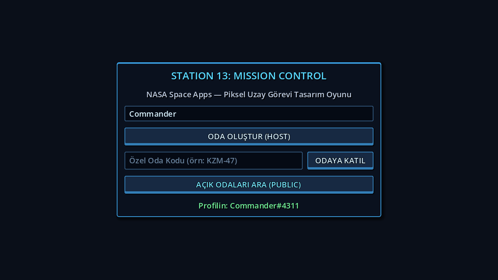
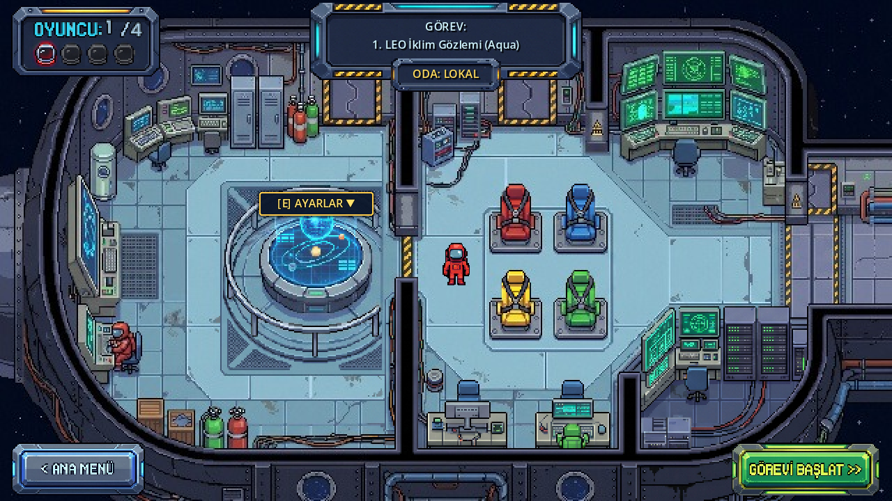
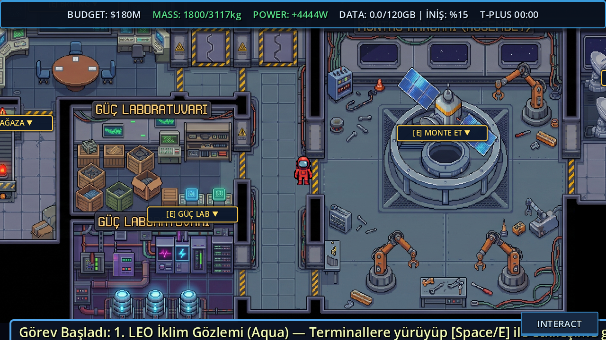
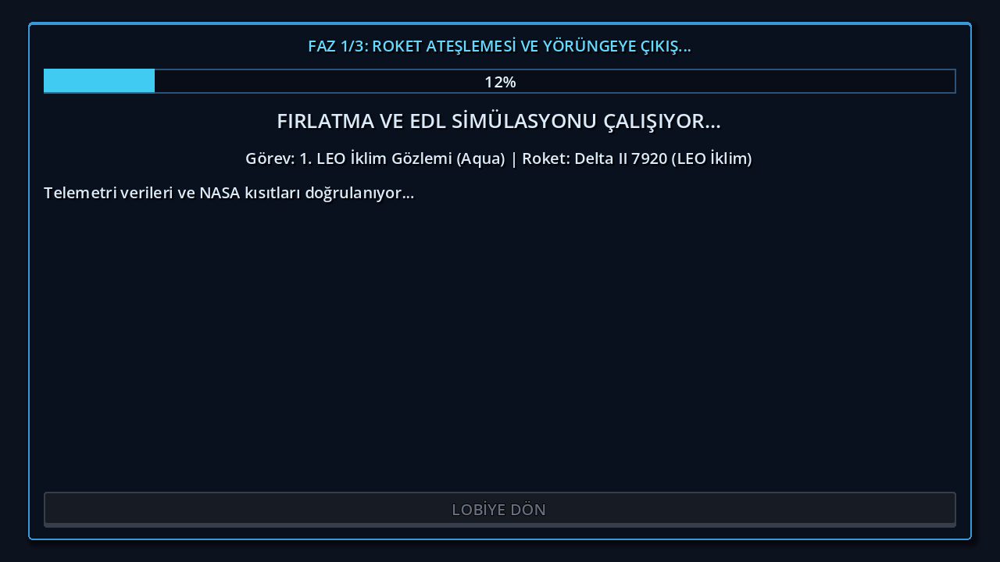

# Station 13: Mission Control

**Station 13: Mission Control**, **NASA Space Apps Challenge** için **Godot 4.7** ile geliştirilmiş 2D piksel-art uzay görevi tasarım ve mühendislik simülasyon oyunudur. Oyuncular (1–4 kişilik co-op / solo lobi) gerçek NASA görev kısıtları altında bütçe, kütle, güç, termal koruma ve Deep Space Network (DSN) veri indirme hedeflerini yöneterek uyduyu monte eder ve fırlatır.

> **Tarayıcıda Oyna (GitHub Pages):** https://emrkngrfdn.github.io/Station13-MissionControl/

---

## Oyun İçi Görseller

### 1. Ana Menü ve Lobi Sistemi


### 2. Bekleme Odası (Mürettebat & Görev Ayarları)


### 3. İstasyon İçi Operasyon (Montaj Hangarı & Terminaller)


### 4. Fırlatma ve EDL Simülasyonu


---

## Temel Özellikler

- **Gerçek NASA Görev Senaryoları:** Kütle limiti, güç bütçesi, bütçe fonu ve fırlatma sahası (Vandenberg AFB / Cape Canaveral) gibi gerçekçi mühendislik kısıtları.
- **Çoklu Oda İstasyon Haritası:**
  - **Brifing Odası:** Görev brifingi, hedef yörünge ve kısıtların incelenmesi.
  - **Tedarik Mağazası & Kargo Bandı:** Bilimsel cihaz, güneş paneli, batarya ve termal sistemlerin satın alınıp bant üzerinden taşınması.
  - **Güç Laboratuvarı:** Enerji dengesi ve güç yönetimi.
  - **Montaj Hangarı (Assembly):** Kargo kutularının taşınarak uydu platformuna monte edilmesi.
  - **DSN İletişim Kulesi:** Deep Space Network üzerinden veri indirme mini oyunu.
  - **Fırlatma Alanı:** Roket ateşleme ve EDL (Entry, Descent, Landing) simülasyonu.
- **Dinamik Derinlik (Y-Sort) & Kamera Takibi:** Her oyuncunun kendi karakterine odaklanan `Camera2D` ve istasyon eşyalarının önüne/arkasına geçilebilen Y-Sort katman yapısı.
- **Özelleştirilebilir Mürettebat:** 4 farklı astronot rengi (Kırmızı, Mavi, Sarı, Yeşil), genel/özel oda seçenekleri ve görev liderlik tablosu.

---

## Kontroller

| Tuş | İşlev |
| --- | --- |
| `W A S D` / `Yön Tuşları` | Astronotu hareket ettir |
| `E` / `Space` | Yakındaki terminal ile etkileşime gir / kargo kutusu al-bırak |

---

## Proje Yapısı

```text
station-13-mission-control/
├── assets/          # Piksel-art harita katmanları, astronot sprite sheet ve UI grafikleri
├── autoloads/       # EventBus, GameState, PlayerProfile, LeaderboardManager
├── data/            # Görev, ekipman ve simülasyon verileri
├── docs/screenshots # Oyun içi ekran görüntüleri
├── scenes/
│   ├── entities/    # player.tscn, helper_drone.tscn, terminal.tscn, cargo_box.tscn
│   ├── ui/          # main_menu.tscn, lobby.tscn, market_ui.tscn, dsn_minigame.tscn, side_quest_modal.tscn
│   └── world/       # waiting_room.tscn, station.tscn, landing_sim.tscn
├── scripts/         # Sahne ve varlık GDScript dosyaları
└── project.godot    # Godot 4.7 proje yapılandırması
```

---

## Kurulum ve Çalıştırma

### Kaynak Koddan Çalıştırma (Godot 4.7+)
1. [Godot Engine 4.7+](https://godotengine.org/) sürümünü indirin.
2. Godot Project Manager üzerinden **Import** diyerek `station-13-mission-control/project.godot` dosyasını seçin.
3. `F5` tuşuna basarak oyunu başlatın (ana sahne: `res://scenes/ui/main_menu.tscn`).

---

## Lisans ve Telif Hakkı

**Copyright © 2026 Emirkan Gürfidan (`emrkngrfdn`). Tüm Hakları Saklıdır (All Rights Reserved).**

Bu projedeki tüm kaynak kodlar, sahneler, sunucu dosyaları ve piksel-art görsel varlıklar telif hakkı ile korunmaktadır. Yazılı izin olmaksızın kopyalanamaz, değiştirilemez, yeniden dağıtılamaz veya başka bir yerde yayınlanamaz. Ayrıntılar için [LICENSE](LICENSE) dosyasına bakın.
